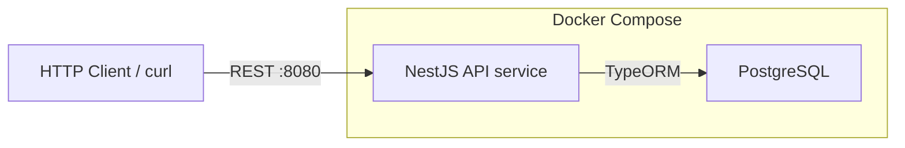
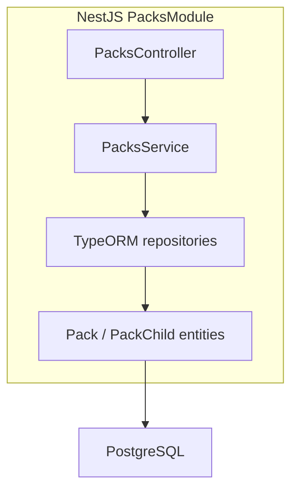
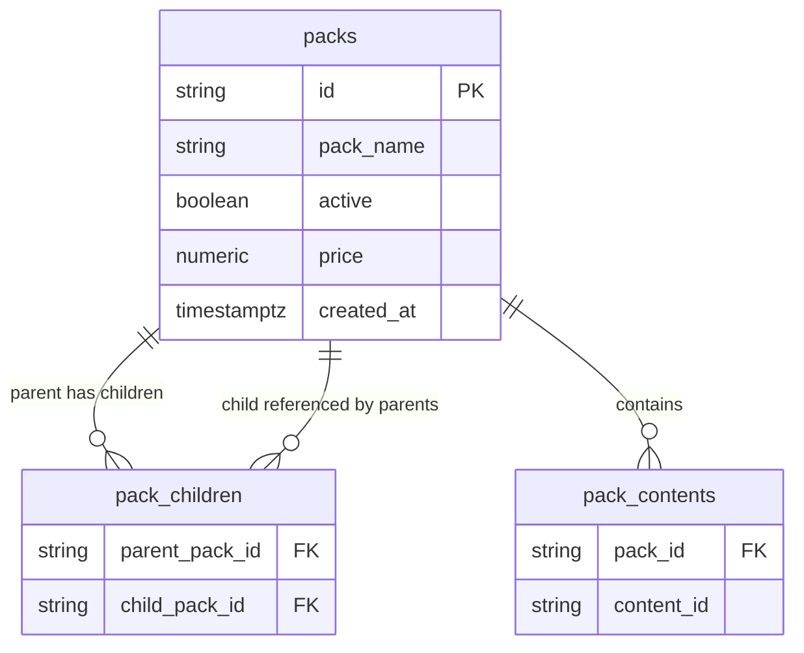
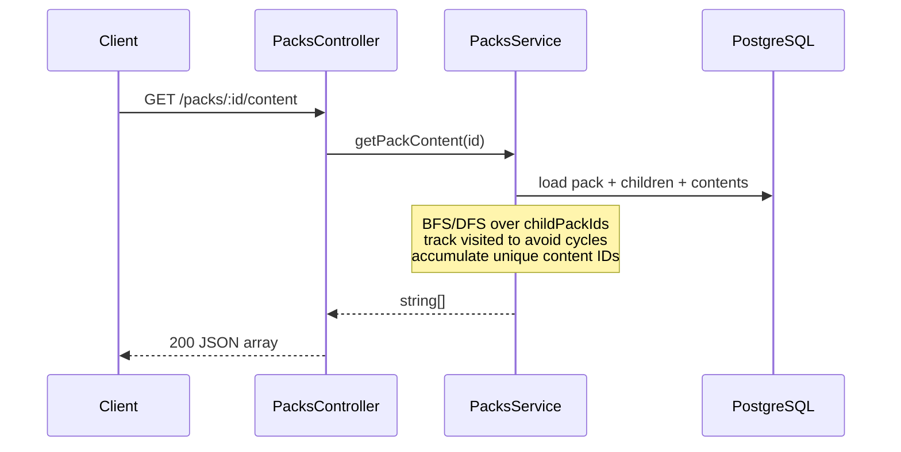

# Game Packs API — High-Level Architecture

## Context

Greenfield assignment: TypeScript REST API for game packs stored in Postgres. Stack locked to **NestJS + TypeORM + PostgreSQL**, started with a single `docker compose up`.

## System overview



Two containers only (assignment scope):

| Component | Role |
|---|---|
| `api` | NestJS app on port `8080` |
| `db` | PostgreSQL; API waits for healthy DB before accepting traffic |

No external/remote services. Env vars (DB host/user/password) live in Compose so reviewers need no local setup.

## Internal application layers



- **Controller**: HTTP mapping for the three endpoints; DTO validation (`class-validator`).
- **Service**: business rules — create/list packs; recursive content resolution with cycle protection.
- **TypeORM**: entities + repositories; schema via migrations (production-like practice preferred over `synchronize`).

## Data model

Packs can nest other packs; content must be flattened uniquely across the tree.



Design choices:

- **`packs.id`**: string business IDs (e.g. `pack.school`) as in the assignment sample.
- **`pack_children`**: self-referential many-to-many (a pack may appear under multiple parents if needed; enforces uniqueness of `(parent, child)`).
- **`pack_contents`**: one row per content item on a pack (avoids JSON-array ambiguity; easy unique constraint per pack).
- Reject cycles on `POST` (child graph must remain a DAG), and still guard recursion at read time.

## API surface

| Method | Path | Behavior |
|---|---|---|
| `POST` | `/packs` | Persist pack + child IDs + content |
| `GET` | `/packs` | List all packs (id, name, active, price, childPackIds, content of that pack only) |
| `GET` | `/packs/:id/content` | Flat unique content of pack **and all descendants** |

### Content resolution flow



Implementation note: prefer **in-app traversal** with TypeORM (clear, testable, easy cycle handling). A Postgres recursive CTE is a valid alternative if you want a single-query talking point in the interview.

## Suggested project shape

```
src/
  main.ts
  app.module.ts
  packs/
    packs.module.ts
    packs.controller.ts
    packs.service.ts
    dto/
    entities/
  database/   # TypeORM config / data source
test/         # e2e or unit tests (Jest)
docker-compose.yml
Dockerfile
```

## Cross-cutting (assignment-scoped)

- **Validation**: DTOs on create (required fields, non-empty id/name, child IDs exist or document create-order policy).
- **Errors**: 404 for missing pack on content endpoint; 400 for invalid payloads / cycle introduction.
- **Tests**: unit tests for content aggregation (nested + cycle); e2e against API (Jest, matching Toca stack).
- **Docker**: API image builds TypeScript; Compose wires `api` → `db` with healthcheck.

## Out of scope (mention as “next steps” in interview / README)

Auth, pagination, soft deletes beyond `active`, caching, OpenAPI UI, CI — not required for the assignment diagram or MVP.
