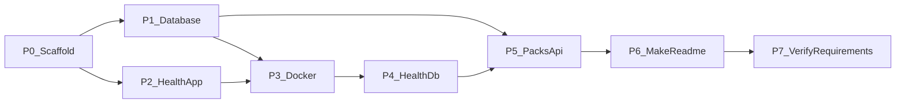

# Master plan — Game Packs API (sequential phases)

This is the **master plan** for implementing the Toca Boca Game Packs assignment. Detailed per-phase plans live alongside this file and are written **before** each phase is implemented (on request).

| Doc | Purpose |
|---|---|
| [`master-plan.md`](master-plan.md) | Roadmap, ownership, commits, agent rules (this file) |
| `p0-*.md` … `p7-*.md` | Detailed plan for one phase — create only when starting that phase |
| [`Architecture.md`](../Architecture.md) | System design |
| [`AGENTS.md`](../../AGENTS.md) | Agent coding rules |
| [`Requirements.md`](../Requirements.md) | Assignment requirements (source of truth for P7) |

## Workflow

1. Implement phases **strictly in order** (P0 → P7). One commit per phase.
2. **Before implementing a phase**, ask for / produce a detailed plan under `docs/plans/` (e.g. `p0-scaffold.md`). Do not start coding that phase until the detailed plan is agreed.
3. After the phase commit lands, mark progress here (status table below).
4. **After implementing a phase, always update that phase’s Done checklist** in its `docs/plans/p*.md` (check every completed item) **and** this master-plan status table.

## Status

| Phase | Status | Detailed plan | Commit |
|---|---|---|---|
| P0 Scaffold | done | [`p0-scaffold.md`](p0-scaffold.md) | `chore: scaffold NestJS app with Vitest, ESLint, and config` |
| P1 Database | done | [`p1-database.md`](p1-database.md) | `feat: add TypeORM entities and Postgres migrations for packs` |
| P2 Health (app) | done | [`p2-health-app.md`](p2-health-app.md) | `feat: add application health endpoint` |
| P3 Docker Compose | done | [`p3-docker-compose.md`](p3-docker-compose.md) | `chore: add Docker Compose for api and Postgres` |
| P4 Health + DB | done | [`p4-health-db.md`](p4-health-db.md) | `feat: include database readiness in health check` |
| P5 Packs API | done | [`p5-packs-api.md`](p5-packs-api.md) | `feat: implement packs REST API with unit and e2e tests` |
| P6 Makefile + README | done | [`p6-makefile-readme.md`](p6-makefile-readme.md) | `docs: add Makefile and README for setup and usage` |
| P7 Requirements verify | done | [`p7-verify-requirements.md`](p7-verify-requirements.md) | `chore: verify Requirements.md coverage and close gaps` |

---

## Decisions locked

- **Parallelism:** Strictly sequential — phase N starts only after phase N−1 is committed (zero file conflicts).
- **Tests:** Vitest + Supertest (update `AGENTS.md` off Jest when scaffolding).
- **Business rules** (missing child IDs, duplicate pack id, inactive packs in content): **ask at implementation** during Packs phase — do not invent.
- **Stack:** NestJS, TypeORM, `pg`, `class-validator` + `class-transformer`, `@nestjs/config`, Vitest + Supertest, Docker Compose, Makefile.

## Phase dependency graph

Each phase = **one focused git commit**. Do not touch files outside that phase’s ownership (except P7 gap fixes).

---

## P0 — Project scaffold and tooling

**Goal:** NestJS TypeScript app boots locally; tooling and deps locked.

**Owns:** Nest bootstrap (`src/main.ts`, `src/app.module.ts`), `package.json` / lockfile, `tsconfig*`, ESLint, Vitest config + coverage thresholds, `@nestjs/config` wiring, update `AGENTS.md` test runner to Vitest.

**Depends on:** nothing.

**Done when:** `npm run start` (or nest start) runs; `npm run lint` and empty/smoke Vitest run work; coverage thresholds configured (floors per AGENTS.md).

**Commit:** `chore: scaffold NestJS app with Vitest, ESLint, and config`

---

## P1 — Database layer (TypeORM + PostgreSQL schema)

**Goal:** Entities + migrations matching `docs/Architecture.md` (`packs`, `pack_children`, `pack_contents`).

**Owns:** `src/**/entities/`, TypeORM module/data-source, migrations folder, DB env keys via config (no Compose yet if possible — connection config ready for later).

**Depends on:** P0.

**Done when:** Entities compile; migration generates/applies against a local Postgres (document command); no HTTP packs logic yet.

**Local DB (locked):** Use a **dedicated** Docker container named `toca-postgres` (`postgres:16`, `POSTGRES_USER=toca`, `POSTGRES_PASSWORD=toca`, `POSTGRES_DB=toca_packs`). Prefer host port **5432**; if busy use **55432** and set `DATABASE_PORT` accordingly. **Never reuse** unrelated containers (`account-postgres`, `keycloak-postgres`, etc.). Exact `docker run` lives in [`p1-database.md`](p1-database.md).

**Commit:** `feat: add TypeORM entities and Postgres migrations for packs`

---

## P2 — Health endpoint (application only)

**Goal:** `GET /health` reports process/app liveness (no DB dependency yet).

**Owns:** `src/health/**` only; register `HealthModule` in `app.module.ts`; unit test for health controller/service.

**Depends on:** P0.

**Done when:** `GET /health` returns 200 with a clear app-up payload; Vitest unit test green.

**Commit:** `feat: add application health endpoint`

---

## P3 — Docker Compose (one-command stack)

**Goal:** `docker compose up` starts **api + db** with no reviewer-supplied env files.

**Owns:** `Dockerfile`, `docker-compose.yml`, any `.dockerignore`; Compose healthcheck on `db`; API waits for DB; port **8080**.

**Depends on:** P0 + P1 (image must connect with TypeORM config); P2 so health exists for optional API probe.

**Done when:** Fresh clone + `docker compose up` brings stack up; API reachable on 8080; DB persistent volume OK.

**Commit:** `chore: add Docker Compose for api and Postgres`

---

## P4 — Health endpoint includes DB readiness

**Goal:** Extend health to verify application **and** database.

**Owns:** `src/health/**` only (and Compose healthcheck pointing at `/health` if not already).

**Depends on:** P1–P3.

**Done when:** Healthy stack → `/health` shows app + db OK; DB down → readiness fails appropriately; tests updated.

**Commit:** `feat: include database readiness in health check`

---

## P5 — Packs REST API with TDD

**Goal:** Required endpoints + unit and e2e tests; iteratively fix issues.

**Owns:** `src/packs/**`, packs e2e tests; ask human before coding ambiguous rules.

**Endpoints:**

- `POST /packs`
- `GET /packs`
- `GET /packs/:id/content` (flat unique nested content, cycle-safe)

**Depends on:** P1 + P4 (stack + health stable).

**Done when:** TDD: failing tests → implementation; unit + e2e green; coverage thresholds still met; validation/`400`/`404` production-ready.

**Commit:** `feat: implement packs REST API with unit and e2e tests`

---

## P6 — Makefile + README

**Goal:** Supporting commands + reviewer docs (setup, usage, AI usage notes per assignment).

**Owns:** `Makefile`, `README.md` (replace/extend assignment stub with setup/usage while keeping assignment context clear). Sync `docs/Architecture.md` only if structure drifted.

**Depends on:** P3–P5 (commands reflect real scripts).

**Done when:** Make targets cover install, test, lint, compose up/down, migrate as applicable; README sufficient for reviewer one-command run + curl examples.

**Commit:** `docs: add Makefile and README for setup and usage`

---

## P7 — Verify against Requirements.md (final)

**Goal:** Audit the finished work against `docs/Requirements.md` and close any gaps before submission.

**Owns:** verification checklist artifact (e.g. `docs/REQUIREMENTS_CHECKLIST.md` or a checked section in README); only the minimal code/docs fixes needed for unmet requirements (may touch earlier areas — this is the only phase allowed to cross-cut for gap fixes).

**Depends on:** P6 (implementation + docs complete).

**Verification matrix (must all pass):**

| Requirement area | Source in Requirements.md | How to verify |
|---|---|---|
| TypeScript API | API / checklist | Project is TS; Nest builds |
| `POST /packs` | API | Manual or e2e: pack persisted |
| `GET /packs` | API | Returns packs with id, packName, childPackIds, active (+ extras OK) |
| `GET /packs/:id/content` | API | Flat unique content including child packs |
| Database persistence | Database | Packs stored in Postgres via TypeORM |
| Production-like tests | Tests | Unit + e2e passing |
| Readable code / lint | Code style | ESLint clean; structure clear |
| `docker compose up` only | Environment | No extra reviewer env; local-only, no remote deps |
| README setup + usage | Documentation | Install/run + curl/query examples |
| AI usage disclosure | AI section | Tools, purpose, full prompt history documented if AI used |
| Official checklist | Checklist | All five submission boxes effectively true |

**Done when:** Every row above is verified (run stack + tests); gaps fixed; checklist recorded so a reviewer/agent can see coverage.

**Commit:** `chore: verify Requirements.md coverage and close gaps`

---

## Agent rules for conflict-free sequential work

1. Start phase only after previous commit exists on the shared branch.
2. Touch **only** that phase’s owned paths (exception: P0 may create empty module stubs; P5 does not rewrite Docker/Makefile; **P7 may cross-cut only to fix requirement gaps**).
3. Follow `AGENTS.md`: TDD, unit + e2e, ESLint, ask when unsure.
4. One commit per phase; no bundling phases.
5. Before coding a phase: write/agree a detailed plan in `docs/plans/` (e.g. `p0-scaffold.md`). Update this master plan status table after the phase commit.
6. **After implementing a phase, always update that phase’s Done checklist** in its `docs/plans/p*.md` (mark every completed item `[x]`) **and** the master-plan status table. A phase is not finished until those docs reflect Done.
7. P7 must use `docs/Requirements.md` as the source of truth — not memory.

## Agent notes

- When using NestJS, TypeORM, class-validator, Vitest, or Docker APIs: fetch current docs via **Context7** before writing code.
- Do not invent outdated APIs from memory.
- For local Postgres before Compose (P1 verify / migrations): always use dedicated `toca-postgres` — never reuse unrelated existing Postgres containers. See [`p1-database.md`](p1-database.md).

## Out of scope until asked

Auth, Swagger, caching, CI, Prettier-as-hard-requirement, extra endpoints beyond health + packs (health is our addition; packs endpoints are required).
