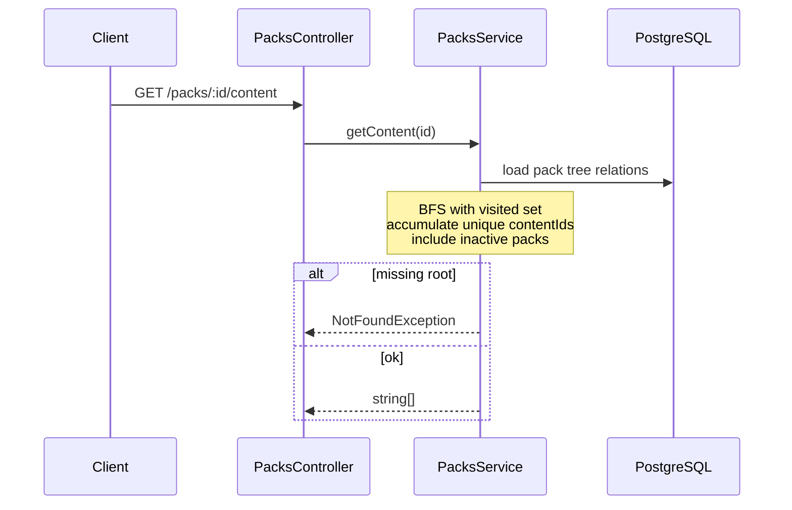

# P5 — Packs REST API implementation plan

Source of truth: [`docs/plans/master-plan.md`](master-plan.md) + [`REQUIREMENTS.md`](../REQUIREMENTS.md). One commit. Do not do Makefile/README (P6) or Requirements audit (P7).

| Field | Value |
|---|---|
| Phase | P5 — Packs REST API with TDD |
| Status | Done |
| Commit | `feat: implement packs REST API with unit and e2e tests` |

## Goal

Implement the three required pack endpoints with validation, production-ready errors, unit + e2e tests, and cycle-safe nested content aggregation.

## Business rules (locked from you + Requirements)

| Rule | Decision |
|---|---|
| `childPackIds` | **Optional** (omit or `[]`). Not required by Requirements. |
| Duplicate pack `id` | **409 Conflict** (no upsert). |
| Missing child references | If `childPackIds` lists ids that are **not** in DB yet → **400** (FK on [`pack-child.entity.ts`](../../src/packs/entities/pack-child.entity.ts) requires the child row). Document create-order: create child packs before parents that reference them. Omitting children never errors. |
| `active: false` | Requirements do **not** say to skip inactive packs → **include** inactive packs in traversal and content. `active` is returned on pack resources only. |
| Cycles | On `POST`, reject graphs that introduce a cycle (**400**). On `GET .../content`, still use a visited-set so cycles cannot hang. |
| Self-child | Reject `childPackIds` containing the pack’s own `id` (**400**). |
| Content resolution | **Locked: in-app BFS** with a `visited` set (not recursive SQL/CTE). Aligns with Architecture and unit-testability. |

Clarification: “childPack not mandatory / don’t throw” = **empty/omitted children are fine**. Throwing only for **duplicate id (409)** or **invalid/cyclic child references (400)** — not for “you forgot children.”

## Content resolution (locked)

1. Load root pack; **404** if missing.
2. **BFS** queue starting at root; maintain `visited` pack ids.
3. For each pack: add its direct `content` ids into a `Set` (unique); enqueue unvisited children from `pack_children`.
4. Include **inactive** packs in the walk.
5. Return `string[]` (array from the set). Prefer loading edges/contents via TypeORM (batched or per-hop at assignment scale)—**no** Postgres recursive CTE in P5.

## Endpoints

| Method | Path | Behavior |
|---|---|---|
| `POST` | `/packs` | Persist pack + optional `content[]` + optional `childPackIds[]` |
| `GET` | `/packs` | All packs: `id`, `packName`, `active`, `price`, `content` (direct only), `childPackIds` |
| `GET` | `/packs/:id/content` | Flat **unique** `string[]` via **in-app BFS** + visited. **404** if pack missing. |

Request DTO (create) aligned with Requirements sample: `id`, `packName`, `active`, `price`, optional `content`, optional `childPackIds`. Validate with `class-validator` (non-empty strings, `price` numeric, arrays of strings, etc.).

## Architecture / code shape

```text
src/packs/
  packs.module.ts
  packs.controller.ts
  packs.service.ts
  packs.service.spec.ts          # content aggregation + cycles + inactive included
  dto/create-pack.dto.ts
  entities/                      # already from P1
test/packs.e2e-spec.ts           # or src e2e via vitest e2e config + real DB
```

Register `PacksModule` in [`src/app.module.ts`](../../src/app.module.ts) (`TypeOrmModule.forFeature` for Pack / PackChild / PackContent).



## Implementation steps (TDD)

1. Context7: NestJS validation pipe DTOs, TypeORM repository transactions, Vitest + Supertest e2e against Nest.
2. **Unit tests first** for pure aggregation helper / service BFS: nested unique content, diamond graph (shared child), cycle protection via visited, inactive pack still included, missing root → 404. Do not implement recursive SQL.
3. **Create DTO + failing controller/service tests** for POST validation, 409 duplicate, 400 cycle / self-ref / unknown child id, happy path.
4. Implement `PacksService`:
   - `create`: transaction; reject duplicate; validate children exist; cycle check on prospective edges; insert pack + contents + child links.
   - `findAll`: map entities to API shape.
   - `getContent`: traverse with visited set; unique content ids; 404 if missing.
5. Wire controller routes; ensure global `ValidationPipe` already in [`main.ts`](../../src/main.ts) covers DTOs.
6. **E2E** (Compose DB or `toca-postgres`): create leaf → parent → list → nested content; 404 content; 409 duplicate; cleanup between tests (truncate tables).
7. Verify: `pnpm lint`, `test`, `test:cov`, `build`; optional curl against Compose on 8080.
8. Write [`docs/plans/p5-packs-api.md`](p5-packs-api.md); mark Done + master-plan P5 **done** after land.
9. **Commit:** `feat: implement packs REST API with unit and e2e tests`

## Error matrix

| Case | Status |
|---|---|
| Invalid body | 400 |
| Duplicate `id` | 409 |
| Unknown `childPackId` / self-ref / cycle | 400 |
| Pack not found for content | 404 |

## Done checklist (check only after implementation)

- [x] `POST /packs`, `GET /packs`, `GET /packs/:id/content` match Requirements shapes/behavior
- [x] Optional `childPackIds`; 409 on duplicate id; inactive packs included in content
- [x] Cycle-safe aggregation; unit + e2e green; coverage thresholds intact
- [x] Validation and error codes as above
- [x] `docs/plans/p5-packs-api.md` Done checklist + master-plan status updated
- [x] Single commit with message above

## Agent notes

- Ask again only if Requirements and this plan conflict mid-implementation.
- Do not change health/Docker except registering `PacksModule`.
- pnpm; update Done checklist after the phase.
- Prefer creating packs bottom-up when linking children (FK).
